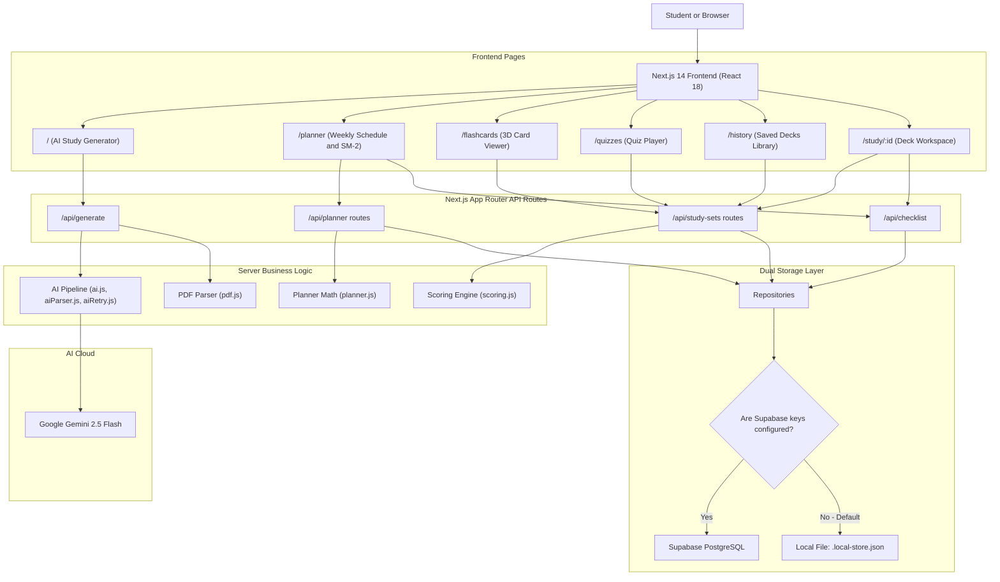
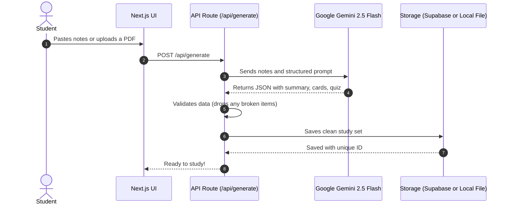
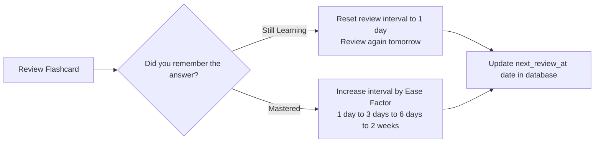
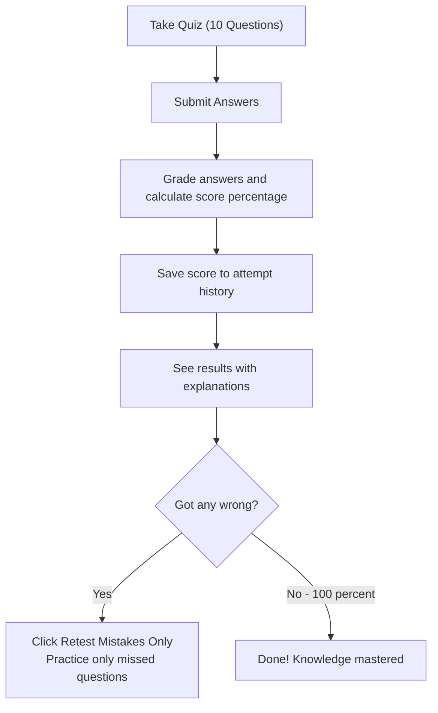

# StudyGold — Handwritten AI Study Generator & Planner 📚

StudyGold is a friendly, smart study assistant and schedule planner built with Next.js 14 and Google Gemini AI. It has the warm look and feel of a hand-drawn paper notebook (`#fdfbf7` dot grid, wobbly borders, handwritten fonts), but behind the scenes it automatically turns your messy lecture notes or PDFs into ready-to-study flashcards, quizzes, checklists, and spaced repetition schedules.

> **Simple by Design:** 100% plain JavaScript (no complex TypeScript types). Works out-of-the-box with zero login required. If you don't connect a cloud database, it automatically saves everything directly in a local file on your computer.

---

## Architecture Diagram

Here is a visual map of how the entire system fits together:



---

## How It Works in 3 Simple Diagrams

### 1. Generating Cards from Your Notes


### 2. Spaced Repetition (SM-2) Flow
When you review cards, StudyGold calculates when you should see each card again based on how well you know it:



### 3. Taking a Quiz & Retesting Mistakes


---

## Complete Codebase Breakdown

Here is what every file and folder in this project does, written in plain English:

### 1. `app/` (Pages and API Routes)
- **`app/page.js`**: The home page. Houses the AI Study Generator form and live preview.
- **`app/planner/page.js`**: The Study Planner dashboard with your weekly calendar, focus timer, and streak stats.
- **`app/flashcards/page.js`**: Standalone flashcard study page where you can pick any deck to flip through.
- **`app/quizzes/page.js`**: Standalone quiz page where you can take tests on your decks.
- **`app/history/page.js`**: The library of all your saved decks with search and filtering.
- **`app/study/[id]/page.js`**: A single deck's workspace combining notes, cards, quiz, and checklist in one view.
- **`app/globals.css`**: Handwritten notebook styling, paper dot grid, and soft shadows.
- **`app/api/generate/route.js`**: Handles AI study set creation from text or 15 MB PDF files.
- **`app/api/study-sets/`**: CRUD endpoints for fetching, updating, and deleting study sets.
- **`app/api/study-sets/[id]/progress/route.js`**: Saves whether a card is "mastered" or "learning".
- **`app/api/study-sets/[id]/attempts/route.js`**: Records quiz scores and retrieves past quiz attempts.
- **`app/api/checklist/route.js`**: Lets you add, check off, or delete study checklist tasks.
- **`app/api/planner/`**: Endpoints for weekly summary, exam goals, focus sessions, and rolling overdue tasks to today.

### 2. `components/` (User Interface)
- **`components/generation/`**:
  - `GenerationForm.js`: Input form for text/PDF upload with card count and difficulty controls.
  - `GenerationPreview.js`: Displays tabs for summary, flashcards, quiz questions, and checklist.
  - `RefinementBar.js`: Chat bar to ask AI for edits + instant Undo button.
- **`components/flashcards/`**:
  - `FlashcardViewer.js`: 3D flipping card, keyboard shortcuts (`Space`, `Arrows`, `H`, `M`, `L`), and audio read-aloud.
  - `FlashcardControls.js`: Next/previous buttons, shuffle button, and audio volume toggle.
- **`components/quiz/`**:
  - `QuizPlayer.js`: Interactive quiz taker with number keys `1–4` selection.
  - `QuizResults.js`: Scorecard showing detailed explanations and "Retest Mistakes" button.
- **`components/planner/`**:
  - `WeeklySchedule.js`: 7-day schedule with one-click "Roll Overdue to Today" button.
  - `FocusTimer.js`: Built-in Pomodoro/study timer with streak logger.
  - `ExamGoalsPanel.js`: Exam countdown cards and milestone generator.
  - `PlannerStats.js`: Cards showing current study streak and reviews due today.
- **`components/checklist/StudyChecklist.js`**: Interactive to-do checklist with priority tags.
- **`components/history/StudySetCard.js`**: Deck card in the library showing card count and mastery bar.

### 3. `lib/` (Helpers and Database)
- **`lib/server/ai.js`**: Google Gemini API client and prompt templates.
- **`lib/server/aiParser.js`**: Cleans up AI output, extracts pure JSON, and validates it with Zod.
- **`lib/server/aiRetry.js`**: Automatically retries if Gemini has a temporary hiccup.
- **`lib/server/pdf.js`**: Extracts plain text from uploaded PDF files safely.
- **`lib/server/planner.js`**: Spaced repetition (SM-2) math, study streaks, and overdue task calculations.
- **`lib/server/scoring.js`**: Compares quiz choices to correct answers and pulls out mistake questions.
- **`lib/server/localStore.js`**: Zero-config file storage (`.local-store.json`) when Supabase is not connected.
- **`lib/server/supabase.js`**: Supabase PostgreSQL client connection.
- **`lib/server/repositories/`**: Clean functions for reading and writing data without messy SQL in your routes.
- **`lib/schemas/studySet.js`**: Zod data rules that keep broken data out of your database.
- **`lib/exportStudySet.js`**: One-click download as Anki CSV or clean Markdown.

---

## Quickstart & Local Setup

### 1. Install Node Dependencies
```bash
npm install
```

### 2. Set Up Your API Key
Copy `.env.example` to `.env.local`:
```bash
cp .env.example .env.local
```

Open `.env.local` and paste your free Google Gemini API key:
```env
GEMINI_API_KEY=your_gemini_api_key_here
```

*(Optional: If you want to use Supabase, paste your Supabase URL and keys into `.env.local`. If you leave them blank, StudyGold automatically uses local file storage!)*

### 3. Start the Web App
```bash
npm run dev
```
Open [http://localhost:3000](http://localhost:3000) in your browser.

### 4. Run the Tests
```bash
npm test
```
All 28 automated tests will run and verify AI parsing, scoring, and storage.

---

## Interactive Documentation (MkDocs)

StudyGold includes a full interactive documentation site built with **MkDocs**:

1. **Install MkDocs** (if needed):
   ```bash
   pip install mkdocs mkdocs-material
   ```

2. **Serve the Documentation Locally**:
   ```bash
   mkdocs serve
   ```
   Open [http://127.0.0.1:8000](http://127.0.0.1:8000) to view the documentation with live search, navigation tabs, and dark/light mode.
