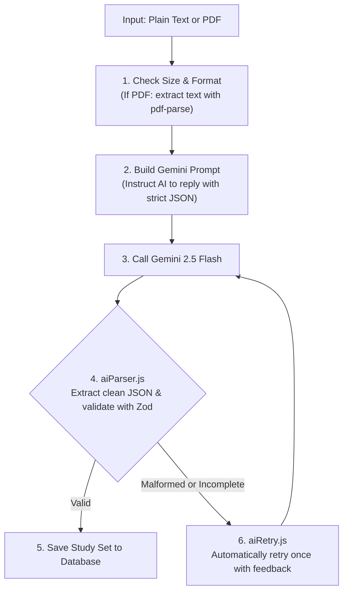

# AI & Gemini Pipeline

StudyGold uses Google's latest **Gemini 2.5 Flash** model via the official `@google/genai` library.

The AI's job is simple: take raw, messy student notes (or an uploaded PDF) and transform them into clean, structured flashcards, quizzes, and study checklists.

---

## How the AI Pipeline Works



---

## 3 Safety Features That Prevent AI Bugs

Working with AI can sometimes lead to broken or weird text. StudyGold has three simple safeguards:

### 1. Pure JSON Extraction (`lib/server/aiParser.js`)
Sometimes Gemini wraps its response in markdown blocks like ````json { ... } ```` or adds conversational text like "Here are your study cards:".
- `aiParser.js` strips out any markdown chatter and finds the exact `{` and `}` boundaries.
- If an item in the JSON is slightly broken, it safely drops that single bad card instead of crashing the whole set.

### 2. Schema Validation with Zod (`lib/schemas/studySet.js`)
Before anything is saved, every single card and quiz question is checked against strict rules:
- Does every flashcard have a `front` and `back`?
- Does every quiz question have exactly 4 choices and a valid correct index (0 to 3)?
- Are the strings non-empty?

If something doesn't match, it gets cleaned or rejected before touching your database.

### 3. Smart Automatic Retry (`lib/server/aiRetry.js`)
If the AI model has a quick hiccup or network timeout:
- StudyGold automatically waits a moment and retries the request once.
- It provides a polite nudge asking Gemini for clean JSON.
- If the user cancels the request (e.g. navigates away), it respects the cancellation immediately and doesn't waste AI tokens.

---

## The In-Context Refinement Loop

After generating a study set, you don't have to keep what the AI gave you. You can ask for edits, such as:
- *"Add 5 more cards about photosynthesis"*
- *"Make the quiz questions harder"*
- *"Summarize the notes in simpler terms"*

When you refine:
1. StudyGold sends your **current** cards back to Gemini along with your new prompt.
2. Gemini edits the set while keeping the good cards you already liked.
3. Your browser saves an **Undo** history so you can jump back if you don't like the new result!
