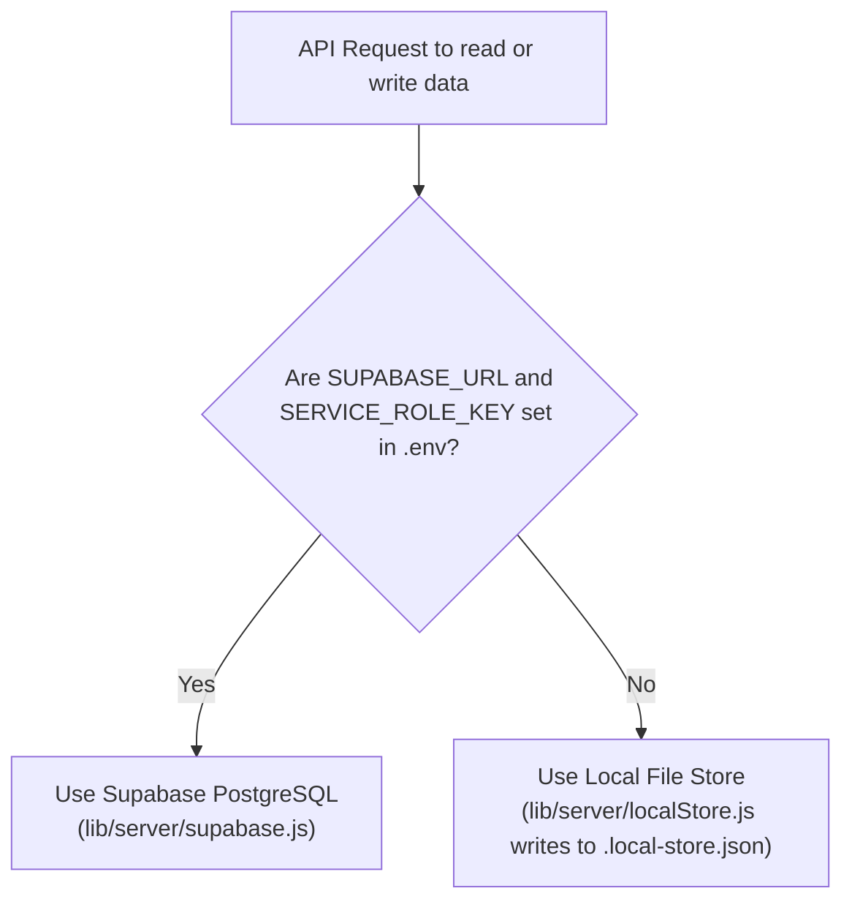
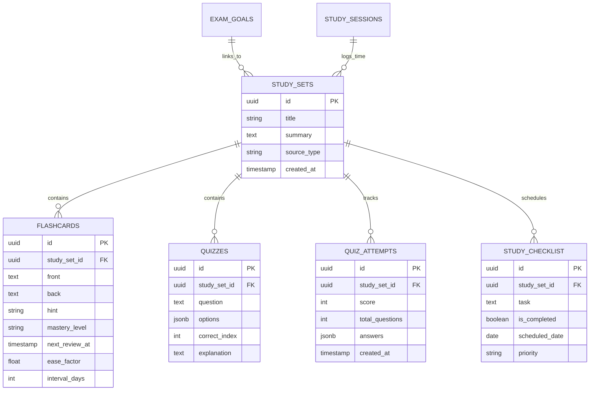

# Data & Storage

StudyGold stores your study sets, flashcard ratings, quiz scores, and planner tasks. 

You can run it in two ways:
1. **Cloud Database (Supabase PostgreSQL)**: Best for permanent storage across devices.
2. **Local File Fallback (`.local-store.json`)**: Best for testing or running offline on your laptop with zero setup.

---

## How Automatic Fallback Works

The code in `lib/server/studySets.js` automatically checks if you provided Supabase credentials:

This means:
- You never get a crashed screen because you forgot to set up database keys.
- You can clone this project, run `npm run dev`, and start studying right away.

---

## The Database Tables (Simple Breakdown)

If you use Supabase, StudyGold creates these clean tables:

### Table Details in Plain Words

1. **`study_sets`**: The main notebook. Holds the study set title, summary notes, and creation date.
2. **`flashcards`**: Every front/back card inside a study set. It also tracks your spaced repetition progress (how many days until you should see it again).
3. **`quizzes`**: Multiple-choice questions for each deck. Stores the 4 choices, which choice is correct (0, 1, 2, or 3), and a friendly explanation.
4. **`quiz_attempts`**: A record of every time you take a quiz. Shows how many points you scored and which questions you got wrong.
5. **`study_checklist`**: Small actionable tasks (e.g. "Review Chapter 3 formulas"). Each task has a due date and priority (`low`, `medium`, `high`).
6. **`exam_goals`**: Your upcoming exams, target dates, and readiness goal percentage.
7. **`study_sessions`**: Logs every time you use the Focus Timer (e.g. 25 minutes of studying), which keeps track of your daily study streak.

---

## Where to Find the SQL Migrations

The database setup scripts live in the `supabase/migrations/` folder:
- `20261108000000_create_study_tables.sql`: Core tables for sets, cards, quizzes, and checklist.
- `20261111000000_add_planner_features.sql`: Planner features, exam goals, and focus sessions.
