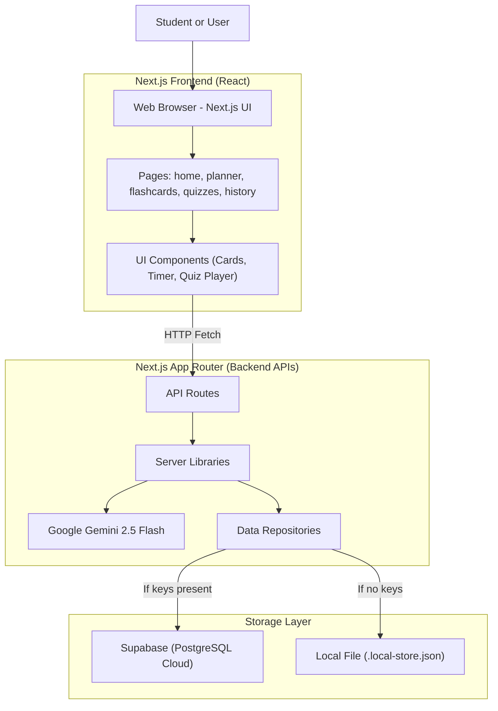
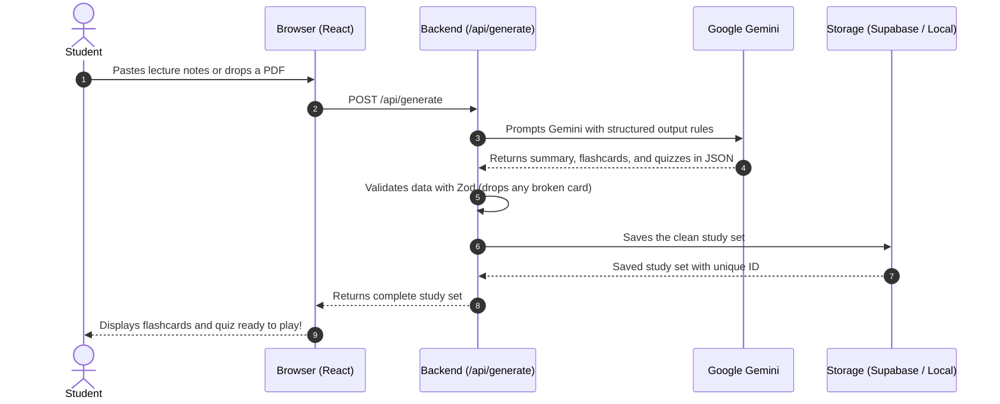

# How StudyGold Works (Architecture)

StudyGold is built as a single, clean Next.js application. Everything lives in one place: the user interface, the backend API endpoints, and the database connectors.

Here is a simple picture of how the whole system connects:

---

## The Three Main Layers

### 1. The Frontend (What You See)
- Built with **React 18** and **Next.js 14 App Router**.
- Uses **Tailwind CSS** with custom paper-like styles (notebook dot grid, subtle paper borders, warm handwritten fonts like `Kalam` and `Patrick Hand`).
- Fast and responsive: flipping a card, filtering a list, or answering a quiz happens instantly in your browser without reloading the page.

### 2. The Backend (The Brain)
- Lives inside the `app/api/` folder.
- When you click "Generate Study Set", the browser sends your notes or PDF to `/api/generate`.
- The backend cleans up your input, sends a carefully written prompt to **Google Gemini 2.5 Flash**, verifies that the AI's reply is in the exact format needed, and saves the result.

### 3. The Storage Layer (Zero-Hassle Saving)
StudyGold has a smart fallback:
- **With Supabase:** If you provide your Supabase URL and key in `.env.local`, it stores your sets, card ratings, and quiz scores in PostgreSQL.
- **Without Supabase:** If you don't have a Supabase account yet, **it still works completely!** It writes all data safely to a file called `.local-store.json` on your computer.

---

## A Typical User Journey

