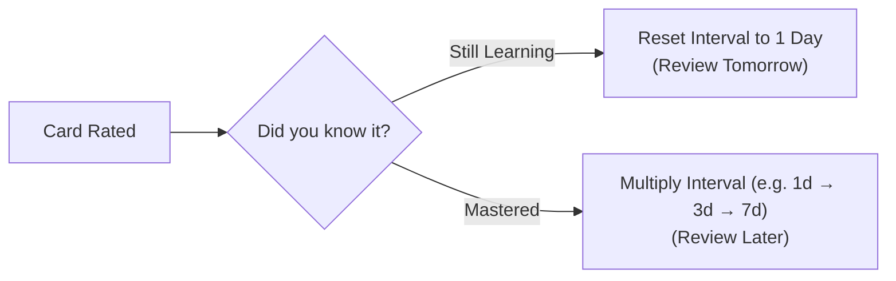

# Study Planner & Spaced Repetition (SM-2)

The **Study Planner** (`/planner`) helps you plan your study routine, stay consistent, and remember facts long-term using the proven **SM-2 Spaced Repetition algorithm**.

---

## 1. What is Spaced Repetition (SM-2)?

When you learn something new, your brain forgets it over time unless you review it. But reviewing every card every day wastes hours of study time.

**Spaced Repetition** solves this by scheduling cards right as you are about to forget them:
- Hard cards you get wrong are reviewed **tomorrow**.
- Easy cards you know well are pushed back **3 days**, then **6 days**, then **2 weeks**.

### The Math Behind SM-2 (Simple Explanation)
In `lib/server/planner.js`, every flashcard has:
- `interval_days`: How many days until you should see it again.
- `ease_factor`: A multiplier (starts at 2.5) that grows when you get cards right and shrinks when you struggle.

When you mark a card as **Mastered**:
$$\text{Next Interval} = \text{Previous Interval} \times \text{Ease Factor}$$

---

## 2. Weekly Schedule & Overdue Rescheduling

The Planner page shows your 7-day calendar:
- See which study checklist tasks are scheduled for **Monday through Sunday**.
- Mark tasks as done directly from the calendar.
- **Overdue Rescheduler:** If life got busy and you missed a few tasks yesterday, you don't have to reschedule them by hand. Click **"Roll Overdue to Today"** (`/api/planner/reschedule`) and it moves all uncompleted past tasks forward to today with one click.

---

## 3. Exam Goals & Auto-Milestones

Have an exam coming up?
1. Enter your exam title (e.g. *"Final Chemistry Exam"*).
2. Set the target date and your readiness goal (e.g. 90%).
3. StudyGold can automatically split the time between today and exam day into manageable study milestones on your schedule.

---

## 4. Built-in Focus Timer

Procrastination happens to everyone. StudyGold includes a built-in **Focus Timer** (`components/planner/FocusTimer.js`):
- Choose a session length (e.g., 25-minute Pomodoro, 15-minute quick sprint, or 45-minute deep focus).
- Starts a clean countdown with pause and reset controls.
- When the timer rings, it records your completed session to the database.
- Tracks your **Study Streak** (how many consecutive days you have studied).

---

## Related Files in Code

| File | Purpose |
| :--- | :--- |
| `app/planner/page.js` | Main planner dashboard. |
| `lib/server/planner.js` | SM-2 calculation logic, streak counter, and planner statistics. |
| `components/planner/WeeklySchedule.js` | 7-day calendar and overdue task rescheduler. |
| `components/planner/ExamGoalsPanel.js` | Exam countdown and milestone creator. |
| `components/planner/FocusTimer.js` | Countdown timer and session logger. |
| `components/planner/PlannerStats.js` | High-level summary cards (streak, due reviews, completion rate). |
